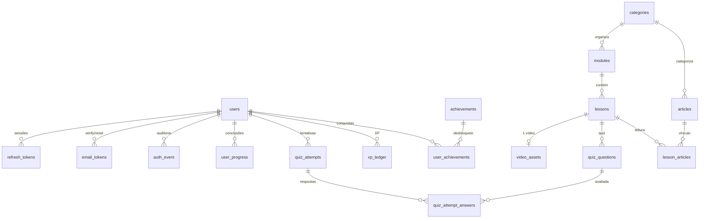

# RELATÓRIO T1 — Skeleton Principal do Backend (Invest Fácil)

**Status: `Código implementado` → `Teste executado` (build e testes evidenciados)**
**Data: 2026-11-15 | Autor: arquiteto principal (GLM) | Local: `<workspace>\_staging\backend-skeleton`**

> Construído em `_staging` porque `backend/` ainda contém o módulo duplicado
> `market-data` (Nemotron) e a condição "backend/ livre" não foi confirmada.
> Promoção para `backend/` = **cópia pura**, somente após autorização do owner.

---

## 1. Stack (conforme missão)

| Item | Escolha | Evidência |
|---|---|---|
| Java | 21 (`java.version=21`, javac `release 21`) | build log |
| Spring Boot | 3.5.6 (parent) | pom.xml |
| Web/Segurança/JPA/Validation/Actuator | starters oficiais | pom.xml |
| Flyway | core + `flyway-database-postgresql` | pom.xml |
| PostgreSQL | driver runtime + Testcontainers (`postgres:17-alpine`) | pom.xml |
| Springdoc | `springdoc-openapi-starter-webmvc-ui` 2.8.9 | compatível com Boot 3.5.6 (confirmado em runtime) |
| JUnit 5 + spring-security-test + spring-boot-testcontainers | testes | pom.xml |
| GeoIP | **não transportado** (geoip2/mmdb/GeoLocationService ausentes por decisão) | V1/V2 |

## 2. Estrutura de arquivos

```
pom.xml, .env.example, .gitignore
src/main/java/com/investfacil/api/
  InvestFacilApplication.java
  config/    SecurityConfig.java, OpenApiConfig.java
  common/error/  ApiError.java, GlobalExceptionHandler.java
  auth|users|content|videos|progress|gamification|market/  package-info.java (fronteira do monólito modular)
src/main/resources/
  application.yml (+dev, +prod) — credenciais 100% via env, fail-fast
  db/migration/V1__init.sql (17 tabelas, schema investfacil)
  db/migration/V2__postgres_security.sql (papéis, grants, RLS)
src/test/java/com/investfacil/api/
  FlywaySecurityIntegrationTest.java (Testcontainers)
  common/error/GlobalExceptionHandlerTest.java
  SecretsScanTest.java
```

## 3. Diagrama ER (V1, schema `investfacil`)



Tabelas: users, refresh_tokens (hash SHA-256, rotação `replaced_by`), email_tokens,
auth_event (auditoria append-only — substitui o fluxo GeoIP da RBS), categories,
modules, lessons, video_assets (Supabase Storage via storage_path), articles,
lesson_articles, user_progress (único por user+lesson), quiz_questions (options jsonb),
quiz_attempts, quiz_attempt_answers, xp_ledger (append-only), achievements,
user_achievements. Papéis USER/ADMIN com CHECK constraint; role vem do banco.

## 4. Segurança do PostgreSQL (V2) — camadas separadas

1. **PostgREST**: `REVOKE ALL ON SCHEMA investfacil FROM PUBLIC/anon/authenticated` — o
   schema do app **não** é exposto; única porta de entrada é o backend Java.
2. **Privilégio mínimo**: `investfacil_app` (NOLOGIN, DML) vs `investfacil_migrate`
   (NOLOGIN, DDL). Senhas NUNCA em migrations — o LOGIN de runtime é provisionado fora
   do repositório (`GRANT investfacil_app TO investfacil_runtime;` documentado em
   `.env.example`).
3. **RLS deny-by-default**: habilitada em todas as tabelas de aplicação; policy `app_rw`
   exclusiva do papel `investfacil_app`. Papel sem policy vê **0 linhas** mesmo com
   `GRANT SELECT` — provado pelo papel de teste `investfacil_test_guest`.
4. **`flyway_schema_history`** excluída de RLS/policy (tabela interna do Flyway) e com
   `REVOKE ALL` dos papéis de runtime — deadlock descoberto e corrigido (item 6).
5. **Autorização USER/ADMIN**: responsabilidade do Spring Security (T2), não do banco.

**Validação com papéis distintos (FlywaySecurityIntegrationTest, PostgreSQL real):**
- Flyway aplica V1+V2 em banco limpo ✔
- `SET ROLE investfacil_app`: INSERT/SELECT OK; **DDL → SQLException** ✔
- `SET ROLE investfacil_test_guest` (com GRANT SELECT): **0 linhas** ✔

## 5. Configuração e perfis

- `application.yml`: datasource/env fail-fast (`${SPRING_DATASOURCE_URL:}` vazio → não sobe),
  Hikari pool 5 (Supabase free tier), `ddl-auto: validate` (schema só do Flyway),
  `include-stacktrace: never`, CORS por env (`CORS_ALLOWED_ORIGINS`, nunca `*` com credenciais),
  actuator com liveness/readiness.
- CSRF desabilitado por decisão (tokens no header); quando o refresh passar a cookie
  HttpOnly/Secure/SameSite=Strict (T2), proteção documentada em SECURITY.md.
- Swagger: `/v3/api-docs` → **"Invest Fácil API" v1, esquema bearerAuth**; `/swagger-ui.html` 200.

## 6. Problemas encontrados e corrigidos durante o build (log honesto)

1. **Compilação do teste** (`mapMulti` genérico, tipos inferidos) — reescrito.
2. **Falso positivo do SecretsScanTest** — scanner agora ignora linhas de comentário.
3. **Docker Desktop 29.8.2 + Testcontainers 1.21.3**: o proxy TCP do Desktop rejeita
   paths de API ≤ 1.44 (docker-java usa default 1.32 → `BadRequestException 400`).
   Diagnóstico: daemon OK por HTTP puro; a falha era do cliente Java.
   Workaround reversível nesta máquina: listener TCP 2375 habilitado no Docker Desktop
   (`ExposeDockerAPIOnTCP2375` — backup em `settings-store.json.bak`) + perfil Maven
   **opcional** `-Pdocker-desktop-newapi` no pom. CI/outras máquinas não usam o perfil.
4. **Deadlock na V2**: `apply_table_security()` tentava `ALTER TABLE ... ENABLE RLS` na
   própria `flyway_schema_history`, em conflito com a conexão de lock do Flyway
   (comprovado via `pg_stat_activity`/`pg_locks`: conexão `idle in transaction` do
   Flyway bloqueava a migration indefinidamente). Correção: exclusão + `REVOKE`.
   Validado manualmente (psql) e no Testcontainers.
5. **Ambiguidade de bean** (`CorsConfigurationSource`: meu bean vs `mvcHandlerMappingIntrospector`)
   — resolvido com `cors(Customizer.withDefaults())`.
6. App não sobe sem datasource (comportamento desejado, fail-fast confirmado).

## 7. Evidências de execução

- Comando: `mvn -B clean verify -Pdocker-desktop-newapi`
- Resultado: **`BUILD SUCCESS`** — `Tests run: 10, Failures: 0, Errors: 0, Skipped: 0`
  - `GlobalExceptionHandlerTest` 4/4 (404, 400 validação, 400 corpo ilegível, 500 sem vazamento)
  - `FlywaySecurityIntegrationTest` 4/4 (PostgreSQL real via Testcontainers)
  - `SecretsScanTest` 2/2 (`.env` ausente; nenhum padrão de segredo em pom/sources/resources)
- Log completo: `build_t1.log`; artefato: `target/investfacil-api-0.1.0-SNAPSHOT.jar`
- Runtime real (Postgres efêmero + jar): `/v3/api-docs` 200, `/swagger-ui.html` 200,
  `/actuator/health` `{"status":"UP","groups":["liveness","readiness"]}`,
  `GET /api/v1/users/me` sem token → **403** (fail-closed).

## 8. Limitações registradas (não são pendências de código)

- O perfil `docker-desktop-newapi` é específico da máquina atual (Docker Desktop 29).
- `request.getRequestId()` no MockMvc devolve traceId vazio; em servlet real gera ID.
- Sem entidade JPA ainda — `ddl-auto: validate` não valida nada além do schema; cada
  módulo trará entidades na T2+.

## 9. Pendências (owner)

1. **Autorizar promoção** do skeleton `_staging\backend-skeleton` → `backend/` (cópia pura
   + re-verify in place) após quarentena do `backend\market-data` pelo Nemotron.
2. Credenciais Supabase (runtime `investfacil_app` + Flyway `investfacil_migrate`) via env.
3. Resend API key (T2 — verificação de e-mail/reset).
4. URL do Figma (frente visual, em paralelo).

## 10. Próxima tarefa delegável ao Nemotron (M2)

**Escopo restrito, nada de arquitetura/segurança:**
Criar `docker-compose.yml` + `Dockerfile` multi-stage (Eclipse Temurin 21, jar em camada,
usuário não-root) para o módulo `market` consumir localmente, e script `verify.ps1` que
executa `mvn clean verify -Pdocker-desktop-newapi` com as envs corretas.
Proibido: alterar SecurityConfig, migrations, GlobalExceptionHandler, pom (exceto com aprovação).
Critério de aceite: `docker compose up` sobe a API com health UP e Swagger acessível.

## 11. T2 (planejada, responsabilidade do arquiteto)

Auth completa: JWT 15 min + refresh opaco 32B (hash SHA-256, rotação, revogação,
detecção de reuso), verificação de e-mail, reset de senha, rate limiting,
cookies HttpOnly/Secure/SameSite=Strict, SECURITY.md com política CORS/CSRF.