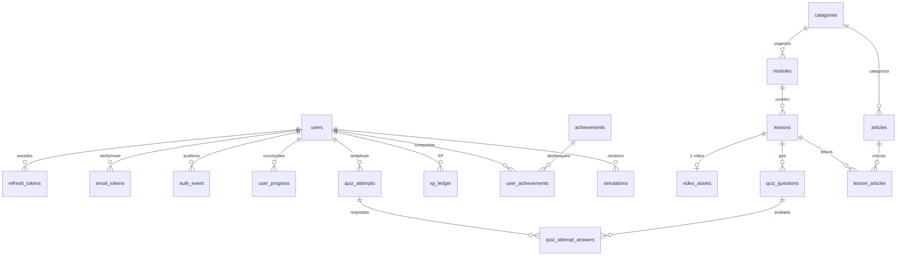

# Banco de dados — Invest Fácil

**Status: V1–V5 implementadas e validadas em PostgreSQL 17 real (Testcontainers).**
Supabase remoto ainda não provisionado.

## 1. Flyway é a fonte única de DDL

Todo o schema nasce de migrations versionadas em
`backend/src/main/resources/db/migration/`:

| Migration | Conteúdo |
|---|---|
| `V1__init.sql` | 17 tabelas do domínio, schema `investfacil` |
| `V2__postgres_security.sql` | papéis, grants, RLS deny-by-default, revogação do PostgREST |
| `V3__auth_mfa_simulator.sql` | MFA/bloqueio, família de refresh, `simulations`, URL externa de vídeo, índice anti-farm |
| `V4__simulation_inflation.sql` | preserva a inflação hipotética no cenário salvo |
| `V5__append_only_ledgers.sql` | revoga UPDATE/DELETE de `auth_event`, `xp_ledger` e `user_achievements` para o runtime |

Hibernate roda com `ddl-auto=validate`: **valida, nunca cria/altere**. Não existe
caminho alternativo de DDL (`supabase/migrations` duplicado é proibido).

## 2. Evolução V3 (detalhe)

### `users`
- `avatar_url`, `mfa_enabled`, `mfa_secret` (AES-GCM), `mfa_last_counter`,
  `failed_login_attempts`, `locked_until`, `last_login_at`.

### `refresh_tokens`
- `family_id uuid NOT NULL DEFAULT gen_random_uuid()` + índice, para revogar a
  família inteira na detecção de reuso. O token cru nunca é armazenado; apenas
  SHA-256 em `token_hash`.

### `video_assets`
- `external_url` opcional para fallback controlado; produção usa o bucket privado.

### `simulations`
- `id`, `user_id` (FK), `name`, `initial_amount`, `monthly_contribution`,
  `months` (1–600), `annual_rate` (0–100), `inflation_rate` (0–100, V4),
  `final_amount`, `invested_amount`, `created_at`; índice por usuário/data; RLS aplicada.

### Append-only real
A V5 revoga `UPDATE`/`DELETE` de `auth_event`, `xp_ledger` e
`user_achievements` para `investfacil_app`. O runtime só pode inserir/ler esses
ledgers; alteração exigiria o owner do banco. Validado por
`FlywaySecurityIntegrationTest.appNaoPodeAlterarLedgersDeAuditoriaOuXp`.

### XP idempotente
Índice único parcial:

```sql
CREATE UNIQUE INDEX ux_xp_once_per_lesson_reason
  ON investfacil.xp_ledger (user_id, lesson_id, reason)
  WHERE lesson_id IS NOT NULL
    AND reason IN ('LESSON_COMPLETED', 'QUIZ_PASSED');
```

Impede farm de XP repetindo a mesma aula/quiz, inclusive sob concorrência.

## 3. Modelo lógico (V1–V5)



Tabelas: `users`, `refresh_tokens`, `email_tokens`, `auth_event`, `categories`,
`modules`, `lessons`, `video_assets`, `articles`, `lesson_articles`,
`user_progress`, `quiz_questions`, `quiz_attempts`, `quiz_attempt_answers`,
`xp_ledger`, `achievements`, `user_achievements`, `simulations`.
(18 tabelas no total; a V4 adiciona apenas a coluna `inflation_rate`.)

## 4. Segurança do banco

| Papel | Tipo | Escopo |
|---|---|---|
| `investfacil_app` | NOLOGIN | DML em todas as tabelas |
| `investfacil_migrate` | NOLOGIN | DDL (USAGE/CREATE) |
| `investfacil_test_guest` | NOLOGIN | `GRANT SELECT` de propósito, para provar RLS |
| `investfacil_runtime` | LOGIN | membro de `investfacil_app`; senha fora do repositório |

- `REVOKE ALL ON SCHEMA investfacil FROM PUBLIC/anon/authenticated`.
- RLS habilitada em todas as tabelas; policy `app_rw` exclusiva do app.
- `flyway_schema_history` sem privilégio de runtime.
- App não pode executar DDL (testado).
- App não pode alterar/apagar ledgers de auditoria/XP (V5, testado).
- Guest com SELECT vê 0 linhas (testado).

## 5. Supabase

- PostgreSQL gerenciado; usar a conexão **direta (5432)** para Flyway. O pooler
  (6543) pode não suportar DDL.
- `investfacil_runtime` provisionado fora do repositório
  (`docs/supabase/PROVISION_RUNTIME_ROLE.sql`).
- PostgREST não expõe o schema; Supabase Auth não é usado.
- Storage separado para vídeos (`docs/supabase/STORAGE_SETUP.sql`).

## 6. Seed de conteúdo

- Conteúdo educativo fica em `backend/src/main/resources/seed/content.json`,
  gerado por `scripts/generate-seed.mjs`.
- O seed é aplicado por `ContentSeedService` de forma idempotente (só quando não
  há categorias) e não cria schema.
- 8 categorias, 8 módulos, 19 aulas, 38 questões de quiz, 6 artigos e 7 conquistas.
- Conta demo é opcional (`APP_DEMO_ENABLED`, `DEMO_PASSWORD`); nunca há senha
  versionada.

## 7. Regras de evolução

- Toda mudança é uma nova migration (V4, V5, ...); V1–V5 são imutáveis após
  ambientes compartilhados.
- Tabelas novas herdam privilégios via `ALTER DEFAULT PRIVILEGES` e recebem RLS +
  policy (função `apply_table_security()` como referência, excluindo o histórico
  do Flyway).
- Índices e constraints pertencem à migration que cria a tabela.
- Antes de migration destrutiva: backup/PITR e janela combinada.
